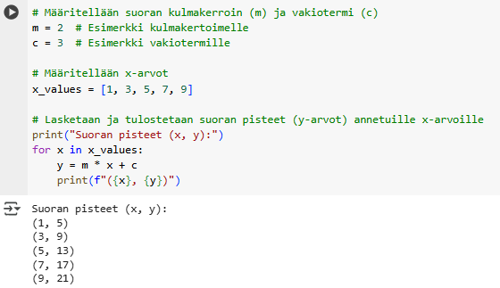

# Python exercise 1: Fibonacci numbers

Lecture date: 28.10.2026

Fibonacci numbers begin is a number series that begins with 0 and 1 and the following entries are sum of preceding two.

**Write a Python code that prints the 15 first Fibonacci numbers.** (Hint: Use of AI is allowed.)

**Return a screenshot of code and output to Moodle.** Below is an example of a screenshot for another piece of code.

The code cell has a gray background and the output has a white background. The example program has been commented in Finnish. The progam defines a straight line with a slope of 2 and a y intercept of 3, and prints (x, y) values on the line for x-values 1, 3, 5,7, and 9.

[Back to lecture notes](Lectures.md)
