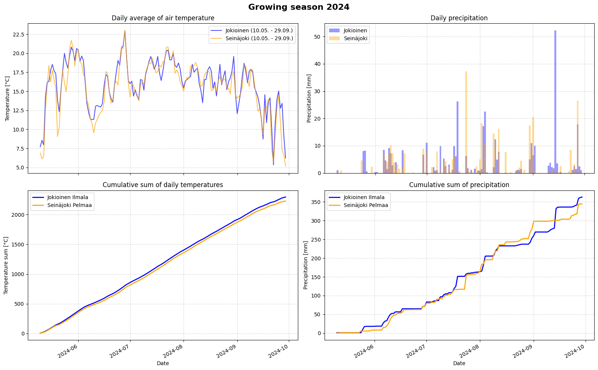

# Viikkotehtävä 2

Annettu [Luennot.md#2-luento-4112026](luennolla 4.11.2026).

Tehtävässä on tarkoitus havainnoillistaa kasvukausia käyttämällä niitä kuvaavia graafeja lämpötilan ja sademäärien kumulatiivisista summista. Nämä kuvaajat havainnollistavat kasvien kokeman sääolosuhteen kertymistä pellolla eri aikoina kasvukautta. Kasvukausi määritellään yhtenäiseksi ajanjaksoksi, jona vuorokauden keskilämpötila pysyy yli +5°C.

Alla oleva koodi lataa GitHub-palvelusta sinne kopioidut Ilmatieteenlaitoksen tuntikohtaiset mittausaineistot ajalta 1.1.2020-27.10.2026 ja mittausasemilta Ilmala Jokioinen (Mustialaa lähin mittausasema) ja Pelmaa Seinäjoella. Ilmatieteenlaitos on lisenssoinut aineiston Creative Commons Nimeä 4.0 Kansainvälinen -lisenssi (CC BY 4.0) -lisenssillä.

Harjoituksen tavoitteena on harjoitella sääaineiston visualisiontia ja käsittelyä. Tuntikohtaisista mittauslukemista pitää laskea päiväkohtaiset lämpötilojen keskiarvot ja sademäärien summat. Näistä lasketaan kumulatiiviset summat ja piirretään ne kuvaajiksi, josta esimerkki alla eräältä sääasemalta ja vuodelta.

Kopio alla oleva koodi itsellesi Python Notebookiin Colab-ympäristössä ja tee vaiheittain ohjeen mukaan. Kannattaa tehdä vaiheet omiin koodisoluihinsa.
1. Huomaat alkukoodin tulosteesta, että aikaleimojen osat ovat jaoteltuina omiin sarakkeisiinsa Year, Month, Day ja Time. Yhdistä nämä sarakkeet datetime-objektiksi, jota voidaan käyttää aika-arvoilla laskemiseen.
1. Laske päiväkohtaiset keskiarvot lämpötiloista ja summat sademääristä ja piirtämään ne kuvaajaan.
1. Laske kasvukauden päivämäärät vuosilta 2021 ja 2025 eli molempien mittausasemien sen yhteinäisen ajanjakson alku- ja loppupäivämäärät, jolloin vuorokauden keskilämpötila oli yli +5°C.
1. Piirrä kuvaajat molempien sääasemien molemmilta vuosilta kasvukausien ajalta lämpötilojen keskiarvoista, sademäärien summista sekä molempien näiden kumulatiivisista summista. Käytä kummankin sääaseman kasvukausien päivämääriä erikseen (siltä varalta, että olet saanut myös niiden yhteiset päivämäärät erikseen).
1. Kirjoita lopuksi lyhyet havainnot tekstisoluun saamiesi kuvaajien perusteella sijaintien ja vuosien eroista.

Palauta lopuksi PDF-tuloste tiedostosta Moodleen.

## Mallikoodi

```
import pandas as pd

# Data of Jokioinen Ilmala
file_path = 'https://raw.githubusercontent.com/hamk-uas/farmdata/refs/heads/main/2026/assets/Jokioinen%20Ilmala_%201.1.2020%20-%2027.10.2026.csv'
df_jokioinen = pd.read_csv(file_path)

# Data of Seinäjoki Pelmaa
file_path = 'https://raw.githubusercontent.com/hamk-uas/farmdata/refs/heads/main/2026/assets/Sein%C3%A4joki%20Pelmaa_%201.1.2020%20-%2027.10.2026.csv'
df_seinajoki = pd.read_csv(file_path)

# Puhdistetaan sarakkeiden nimistä ylimääräiset lainausmerkit ja välilyönnit
df_jokioinen.columns = df_jokioinen.columns.str.replace('"', '').str.strip()
df_seinajoki.columns = df_seinajoki.columns.str.replace('"', '').str.strip()

print(df_jokioinen.head().to_string())
print("")
print(df_seinajoki.head().to_string())
```

## Esimerkki lopputuloksena tulevasta kuvaajasta

Jos saat lopuksi tämänkaltaisen tuloksen, olet varmasti oikeilla jäljillä. Kuvaajien asettelu, värit ja määrä voi vaihdella, mutta käyrien pitäisi likipitäen näyttää tältä.


