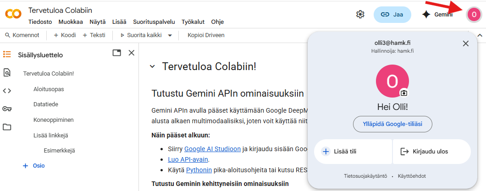

<!-- Translation sync: this file is up to date with the Finnish source 2026/Luennot.md as of commit 46c89f3dfcc6266c31611e98eab40bd8336088a1. To catch up, translate the changes shown by: git diff 46c89f3dfcc6266c31611e98eab40bd8336088a1 HEAD -- 2026/Luennot.md (then update the commit hash here). -->
Autumn 2026

© 2026 HAMK Hämeen Ammattikorkeakoulu. Authors: Pirita Rantala, Olli Koskela, Olli Niemitalo

# 1. Lecture 28.10.2026
<!-- Do not change the lecture heading, because Moodle deep-links to it! Add a short description below! -->

This lecture covers Colab, the use of AI, and Python basics part 1.

### Python

Python is a programming language that is very popular for data analysis. Writing a program for data analysis is convenient because a program only needs to be written once and can then be used repeatedly with different input data. The capabilities of Python can be extended using *modules*, for example in order to easily manipulate tabular data or for plotting, etc. Modules typically have their own online documentation that can be consulted.

Because of Python's popularity, AI tools are very familiar with it and you should seek help using AI (AI) chats. Over the past year, a more modern way of utilizing AI, using AI agents that independently develop programs, has become more powerful than chats. Agents are able to create source code files, run them, test program functionality, and fix bugs. Agent features may also be available in AI chats.

To help AI assist you to the best of its ability, you should tell it in your "prompt" what problem you are trying to solve, what thoughts you have about the solution, how confident you are about them, or whether you want AI to choose the solution methods itself. If an error occurs during program execution, the error message itself is useful information for AI to understand the error, and you should provide it.

Artificial intelligence (AI) tools can help you and you can use those freely in this course for code generation. For you it is probably more important to "get the job done" than to become a fluent Python programmer. You can think of AI as an assistant that writes code for you. Google Gemini AI is covered in the next section. Other useful AI tools for Python code generation include ChatGPT, Gemini, Copilot, Mistral, Grok, Deepseek, Manus, and Claude. Using them to a small extent is free and increasingly many of them are able to run and test code themselves. When credits run out in one service you can switch to another.

If you intend to send AI information that is confidential or private, make sure you have permission to do so. You may need to check the AI service's terms of use and privacy policy for how the data you send is used. Also consider whether you trust the service provider.

## Colab

Colab is a Google service that is available to HAMK students through their Google accounts. In Colab, Python can be used interactively in a Jupyter Notebook.

While not covered in this course, it is possible to install Python and Jupyter Notebook on your own computer. Visual Studio Code is a popular code editor, and Git is a very popular tool for software version control. Version controlling means storing a cumulative history of your source code during development. GitHub is a very popular service to host version controlled software projects.

**Create a new notebook** by opening [<u>https://colab.research.google.com/</u>](https://colab.research.google.com/). You can enter a notebook name of your choice.

**Locate your notebook in Google Drive** by clicking *File*→*Locate in Drive*. You may wish to move the notebook to a folder.

When running Python code in Colab, the code is run in a *runtime*, which is a Google-hosted virtual machine. A runtime is automatically created for you the first time you run a code cell in the notebook.

**Run an empty code cell** by pressing the play button. After a moment, this will have created a runtime for you.

The runtime is a virtual machine, and it has its own local files. All of the runtime’s local files will be deleted when the runtime is deleted. This sometimes happens unexpectedly, and also happens if there is for a period of time no connection from your computer, for example if the notebook browser tab is closed, if your computer goes to sleep, or if your Internet connection goes down. Any data stored in Python variables is also lost upon deletion of the runtime. However, the notebook containing your code is stored in Google Drive and will not be deleted. Unlike with Google Docs documents, you may need to manually save changes you made to the notebook, although sometimes changes get saved automatically.

**Examine the runtime** by exploring the *Runtime* menu.

**Examine the local files on the runtime**, by clicking the folder icon on the left.

**Try creating new text and code cells.**

**Edit the contents of the new cells.**

**Run code in a cell** by pressing Ctrl-Enter (Windows) or Cmd-Enter (Apple) or the play button of the cell.

Colab gives access to Gemini artificial intelligence (AI) features such as *Generate code* button for creating code based on a prompt entered, and the *Explain error* button.

### Switching Google account

The profile icon in the top right corner opens a menu where you can use the Add account option to sign in with a new account.



## Python basics part 1

This subsection covers the basics of Python programming, using code examples. Type or copy-paste each code example into a code cell in Colab, and run the cell. Try to understand the result. Modify the code as instructed and run it again. You can also create a new cell and write your own code in it.

In Python, you can create your own variables. A variable always refers to some value. Values have different types. We will become familiar with some of these types in this section. Depending on the type of value the variable refers to, the variable or rather its value can be used in different ways.

The Python interpreter runs a Python program or code cell line by line from top to bottom. If the interpreter encounters an error, execution is halted and an error message is displayed. The Python interpreter remembers the values of all variables from previously executed code. You can delete all created variables by clicking *Runtime*→*Restart*. This will not delete local files saved during execution.

### Comments, variables, types (numbers, strings), basic math, print

```python
# This is a comment. Comments begin with # and will not be run.

# Assign numerical values to variables
x = 5
y = 2.5

# Assign the result of a basic calculation to a variable
result = x + y

# Print the value of a numerical variable
print(result) # Prints 7.5
```

In Python, spaces at the beginning of each line are used to divide code into blocks, which will be explored later. Otherwise, spaces can be freely added between code to make the code more readable. Appropriate use of spaces makes code more readable.

The last line is also an example of calling a function, in this case Python's built-in print function. A function is called by writing comma-separated input values to parentheses after the function name. A function may return a value. There are many built-in functions, and you can also write your own functions.

### Exercise pause during the lecture

**Change the input numbers and see how the result changes.**

**Create versions of the code that perform 1) subtraction and 2) multiplication.** See: [<u>Python operators</u>](https://www.w3schools.com/python/python_operators.asp).

**Calculate the square root of a number.** You can google or ask AI how to do it.

### Lecture continues

```python
# Assign a string value to a variable
sentence = "My name is"

# Concatenate strings
name = "Peter"
sentence = sentence + " " + name

# Print the value of a string variable
print(sentence)

# Do the same using a formatted string
sentence = f"My name is {name}"
print(sentence)
```

### Exercise pause during the lecture

**Add a second name using another variable.**

**Use the second name in the sentence.** Hint: For example resulting in “Our names are Peter and Eva”.

[Weekly exercise 1](Exercise1.md)

# 2. Lecture 4.11.2026
<!-- Do not change the lecture heading, because Moodle deep-links to it! Add a short description below! -->

In this lecture we make sure everyone can return the weekly exercise as a PDF, revise Python basics (program flow, variables and conditional statements), and start processing weather data and plotting it with the help of AI. These skills are needed in weekly exercise 2.

## Returning the weekly exercise as a PDF

At the start of the lecture we make sure that everyone has managed to make a PDF file of their weekly exercise 1 notebook for returning in Moodle. All weekly exercises are returned the same way.

1. Run all cells of the notebook by selecting *Runtime*→*Run all*. Check that the outputs and plots are visible and that there are no error messages under the cells.
1. Select *File*→*Print* or press Ctrl+P (Mac: Cmd+P).
1. In the browser's print dialog, choose saving to a PDF file as the printer. The name of the option depends on the browser and operating system, but it usually contains the word PDF, for example *Save as PDF* or *Microsoft Print to PDF*. In the Mac print dialog, saving as PDF is found in the *PDF* menu.
1. Open the saved PDF and check that all cells, outputs and plots are included. If long code lines are cut off, try landscape orientation or a smaller scale. If printing does not work at all, try another browser.
1. Return the PDF file in Moodle.

## Using notebooks

Practice these operations during the exercise pauses of the lecture, so that they become routine.

| Operation | How |
|---|---|
| New notebook | *File*→*New notebook in Drive* |
| New code or text cell | *+ Code* or *+ Text* button |
| Running a cell | The cell's play button or Ctrl+Enter (Mac: Cmd+Enter) |
| Moving or deleting a cell | The arrow and trash can buttons in the top right corner of the cell |
| Running all cells from top to bottom | *Runtime*→*Run all* |
| Clearing variables and running all cells | *Runtime*→*Restart session and run all* |
| A completely new runtime | *Runtime*→*Disconnect and delete runtime*, then run any cell or *Run all* |

*Run all* stops at the first cell that causes an error. Fix or delete the cell causing the error and run again.

## Python basics part 2

The goal is not to learn Python by heart, but to understand how a program proceeds and what happens to variables. Then you can also read and check code written by AI and modify it for your own needs.

**Create a new notebook for this lecture** and copy each example into its own code cell.

### A program runs line by line from top to bottom

```python
# Morning temperature
temperature = 4
print("In the morning:", temperature)

# A new value is assigned to the variable, and the old value is forgotten
temperature = 15
print("During the day:", temperature)

# A new value can be calculated from the old value
temperature = temperature - 6
print("In the evening:", temperature)
```

The value of a variable is always the value that was most recently assigned to it. The equals sign `=` does not mean mathematical equality but *assignment*: first the value of the right-hand side is calculated, and then it is stored in the variable on the left. That is why the line `temperature = temperature - 6` calculates a new value from the old value (15 − 6 = 9) and stores it in the same variable.

**Before running it, think about what the following code prints:**

```python
a = 3
b = a + 2
a = 10
print(a, b)
```

<details>
<summary>Answer</summary>

The code prints `10 5`. The value of `b` is calculated on the second line, when `a` is still 3. When a new value is later assigned to `a`, `b` does not change.

</details>

### Cumulative sum

By updating a variable, we can calculate for example the *cumulative sum* of precipitation: for each day, the sum of all precipitation up to and including that day. Cumulative sums are used in [weekly exercise 2](Exercise2.md).

```python
# The cumulative sum is zero at first
total_rain = 0

total_rain = total_rain + 2.5   # Day 1: 2.5 mm of rain
print("Day 1:", total_rain)

total_rain = total_rain + 0.0   # Day 2: no rain
print("Day 2:", total_rain)

total_rain = total_rain + 6.1   # Day 3: 6.1 mm of rain
print("Day 3:", total_rain)
```

### The order in which cells are run

```python
print(rainfall)
rainfall = 3.2
```

The code causes the error `NameError: name 'rainfall' is not defined`, because the first line is run before the variable has been given a value. With the *Explain error* button under the error message you can ask Gemini to explain the error.

In Colab, variables persist from one cell to another, and cells are run in the order in which you run them. If you change a cell higher up, also rerun the cells that use it, or run all cells from top to bottom by selecting *Runtime*→*Run all*.

### Exercise pause during the lecture

**Add a fourth day to the cumulative sum example**, with 1.4 mm of rain.

**Add text cells above the examples** and write a short heading in each, for example `# Cumulative sum`. In a text cell, a `#` at the beginning of a line turns the line into a heading, which is shown in the table of contents on the left.

**Select *Runtime*→*Restart session and run all*.** Execution stops at the `NameError` example. Fix or delete that cell and try again until all cells run through.

### Lecture continues

### Conditional statements: if, elif and else

A comparison such as `temperature > 5` produces a *boolean value* `True` or `False`. With a *conditional statement* (if statement), a program can choose based on data which lines are run. During the growing season, the daily mean temperature is above +5 °C:

```python
temperature = 7.3

if temperature > 5:
    print("The mean temperature is above +5 °C.")
    print("Plants are growing.")
else:
    print("The mean temperature is +5 °C or below.")
    print("Growth has stopped.")

print("Check done")
```

- The `if` line ends with a colon `:`.
- Indented lines form a *block*. The `if` block is run only if the condition is true, and the `else` block otherwise. The `else` part is optional.
- The non-indented line `print("Check done")` is always run.

The comparison operators are `==` (equal to), `!=` (not equal to), `<`, `>`, `<=` and `>=`. Note the difference: `=` assigns a value to a variable, whereas `==` compares two values. Conditions can be combined with `and` (both true) and `or` (at least one true).

There can be more than two alternatives. The conditions are checked from top to bottom, and only the block of the first condition that is true is run:

```python
temperature = -2

if temperature < 0:
    print("Below freezing")
elif temperature <= 5:
    print("Cool, growth does not start yet")
else:
    print("Warm enough for growth")
```

### Exercise pause during the lecture

**Change the temperature so that each of the three alternatives is printed in turn.** Before running, think about what will be printed. What is printed when the temperature is exactly 5?

**Write a conditional statement that prints "Heavy rain" if the value of the variable `rain` is more than 10 mm, and otherwise "Little or no rain".**

## Data processing and plots

### Plotting: matplotlib.pyplot.plot()

Plots are drawn with the pyplot module of the matplotlib library, which is imported with the abbreviation `plt`. The function [`plt.plot()`](https://matplotlib.org/stable/api/_as_gen/matplotlib.pyplot.plot.html) draws a line plot: first you give the x-axis values and then the y-axis values. You can draw several curves in the same plot by calling the function several times.

```python
import matplotlib.pyplot as plt

# A list contains several values in order, inside square brackets
days = [1, 2, 3, 4, 5, 6, 7]
temperatures_jokioinen = [6.1, 7.4, 5.2, 8.9, 10.3, 9.5, 11.0]
temperatures_seinajoki = [4.8, 6.0, 4.1, 7.5, 9.2, 8.8, 9.9]

# "o-" draws the points as circles and connects them with a line, label names the curve
plt.plot(days, temperatures_jokioinen, "o-", label="Jokioinen")
plt.plot(days, temperatures_seinajoki, "o-", label="Seinäjoki")
plt.xlabel("Day")
plt.ylabel("Mean temperature [°C]")
plt.title("Mean temperatures of the week")
plt.legend()  # Legend showing the names of the curves
plt.show()
```

### Exercise pause during the lecture

**Plot the cumulative precipitation from the cumulative sum example** by writing the days and the cumulative sums into lists.

### Lecture continues

### Reading weather data

The following code reads hourly weather observations of the Finnish Meteorological Institute from the Ilmala, Jokioinen or the Pelmaa, Seinäjoki weather station. The same data are used in weekly exercise 2. The file to read is chosen with a conditional statement based on the variable `station`. The data are read into a pandas *DataFrame* table `df`, in which each row is the observation of one hour.

```python
import pandas as pd
import matplotlib.pyplot as plt

# Choose the weather station: "Jokioinen" or "Seinäjoki"
station = "Jokioinen"

if station == "Jokioinen":
    file_path = 'https://raw.githubusercontent.com/hamk-uas/farmdata/refs/heads/main/2026/assets/Jokioinen%20Ilmala_%201.1.2020%20-%2027.10.2026.csv'
elif station == "Seinäjoki":
    file_path = 'https://raw.githubusercontent.com/hamk-uas/farmdata/refs/heads/main/2026/assets/Sein%C3%A4joki%20Pelmaa_%201.1.2020%20-%2027.10.2026.csv'
else:
    # raise stops the program and shows our own error message
    raise ValueError(f"Unknown weather station: {station}")

# Missing observations in the data are marked with a dash "-".
# na_values="-" tells pandas that a dash means a missing value.
df = pd.read_csv(file_path, na_values="-")

# Clean extra quotation marks and spaces from the column names
df.columns = df.columns.str.replace('"', '').str.strip()

display(df.head())
print(df.columns)
```

Without the `na_values="-"` setting, pandas would interpret the temperature and precipitation columns as strings, and they could not be used in calculations. Pandas marks missing values as `NaN` (*not a number*) and skips them for example when calculating a mean. Almost all measurement data contain missing values, so it is a good idea to check them.

A column is selected by writing its name in square brackets. Pandas can directly calculate for example the mean and the cumulative sum (`cumsum()`) of a column. `cumsum()` does the same as the earlier cumulative sum example, but for every row:

```python
print("Missing values per column:")
print(df.isna().sum())

print("Mean temperature over the whole period:", df["Average temperature [°C]"].mean())

rain_cumulative = df["Precipitation [mm]"].cumsum()
print("Cumulative precipitation, last rows:")
print(rain_cumulative.tail())
```

### Selecting rows with a condition

When a column is compared to a value, you get a boolean value for each row separately. It can be used to select the rows of the table for which the condition is true:

```python
is_warm = df["Average temperature [°C]"] > 5
print(is_warm.head())

# Select the rows of one day and plot its hourly temperatures
one_day = df[(df["Year"] == 2025) & (df["Month"] == 7) & (df["Day"] == 15)]

plt.plot(one_day["Time [Local time]"], one_day["Average temperature [°C]"], "o-")
plt.xticks(rotation=90)  # Rotate the x-axis times to vertical
plt.xlabel("Time of day")
plt.ylabel("Temperature [°C]")
plt.title(f"{station} 15.7.2025")  # Formatted string, see lecture 1
plt.show()
```

In pandas conditions, `&` is used instead of `and` and `|` instead of `or`, and each condition is written in parentheses. You do not need to remember details like these, because AI knows them. It is enough that you understand what the code does.

Over a longer period, the times on the x-axis would repeat and you could not see the date. In weekly exercise 2, the columns Year, Month, Day and Time are combined into a single timestamp, which gives dates on the x-axis.

### Exercise pause during the lecture

**Switch the weather station.** Change to `station = "Seinäjoki"` and select *Runtime*→*Run all*. The same code now calculates and plots the results for Seinäjoki. Which station was warmer on 15.7.2025?

**Misspell the station name** and run the cell. What happens?

**Start with a completely new runtime:** *Runtime*→*Disconnect and delete runtime* and then *Runtime*→*Run all*. Because everything needed is in the notebook, it also works when starting from scratch.

### Lecture continues

### Processing data with the help of AI

Colab's Gemini AI can write the code needed for processing data and drawing plots. You can use Gemini for example through the *Generate* link of an empty code cell or through the Gemini button of the Colab window. To get good results:

1. **First run the code that reads the data**, and in the prompt, give the names of the DataFrame, the variables and the columns exactly.
1. **Say what you want to calculate and how the result should be presented**, for example as a plot drawn with the `plt.plot()` function, with axis labels.
1. **Proceed in small steps**, one thing and one code cell at a time.
1. **Read the code and check whether the result makes sense.** For example, the mean temperature of July should be about +15–20 °C. If you do not understand something, ask the AI to explain it.
1. **If you get an error**, press *Explain error* or copy the error message to the AI.

Free use of Colab's Gemini is limited. If you run out of uses or credits, you can use other AI tools, such as ChatGPT, Copilot, Claude, Mistral or Deepseek. They cannot see your notebook, so give everything needed in the prompt: the names of the variables and columns, your own code and any error messages in full. Copy the code you get into a Colab code cell.

Example prompt:

> The DataFrame `df` contains hourly weather observations of a weather station, and the variable `station` contains the name of the weather station. The columns are "Year", "Month", "Day", "Time [Local time]", "Average temperature [°C]", "Precipitation [mm]" and "Average air pressure [hPa]". Calculate the mean temperature and the precipitation sum of each month of 2025 and show them as a table. Plot the mean temperatures with the matplotlib.pyplot.plot function so that the month number is on the x-axis. Add axis labels, and the name of the weather station to the plot title.

The AI answers a bit differently every time, but the result may look for example like this:

```python
# Select the rows of 2025
df_2025 = df[df["Year"] == 2025]

# Group the rows by month and calculate for each month
# the mean of the temperatures and the sum of the precipitation
monthly = df_2025.groupby("Month").agg({
    "Average temperature [°C]": "mean",
    "Precipitation [mm]": "sum"
})
display(monthly)

plt.plot(monthly.index, monthly["Average temperature [°C]"], "o-")
plt.xlabel("Month")
plt.ylabel("Mean temperature [°C]")
plt.title(f"{station}, monthly mean temperatures 2025")
plt.show()
```

The function `groupby()` divides the rows into groups, here by month, and `agg()` calculates the desired statistics for each group. In the same way, the daily means and sums needed in weekly exercise 2 can be calculated from the hourly observations.

### Exercise pause during the lecture

**Ask the AI to plot the monthly precipitation of 2025.** Does the total precipitation of the year make sense? In Finland, the annual precipitation is typically about 500–700 mm.

**Switch the weather station and run all cells.** The code produced by the AI also works for the other station as such: a program is written once and can be used with different data.

**Make a PDF file of this notebook** and check that the plots are visible in it.

[Weekly exercise 2](Exercise2.md)

# 3. Lecture 11.11.2026
<!-- Do not change the lecture heading, because Moodle deep-links to it! Add a short description below! -->

[Weekly exercise 3](Exercise3.md)

# 4. Lecture 18.11.2026
<!-- Do not change the lecture heading, because Moodle deep-links to it! Add a short description below! -->

[Weekly exercise 4](Exercise4.md)

# 5. Lecture 25.11.2026
<!-- Do not change the lecture heading, because Moodle deep-links to it! Add a short description below! -->

[Weekly exercise 5](Exercise5.md)

# 6. Lecture 2.12.2026
<!-- Do not change the lecture heading, because Moodle deep-links to it! Add a short description below! -->

[Weekly exercise 6](Exercise6.md)

# 7. Lecture 9.12.2026
<!-- Do not change the lecture heading, because Moodle deep-links to it! Add a short description below! -->

(No new weekly exercise)

# After the lecture series

The report presentations session is on 15.12.2026. Try to utilize the programmatic data analysis skills you've gained in your presentation and report. For example, you can acquire and merge external data into your project data and analyze them together, using Python in whatever work stages you want.

The exam will include questions about the weekly exercises.
