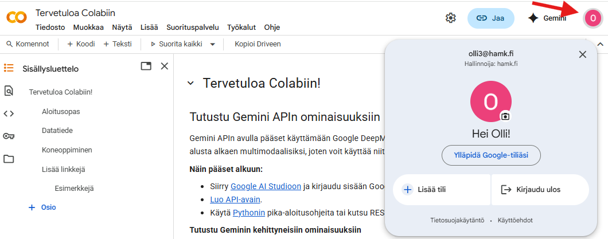

## Programmatic data analysis lecture notes / Ohjelmallisen data-analyysin luentomuistiinpanot

- [Exploiting agricultural data - Programmatic data analysis (English)](2026/Lectures.md)
- [Maatalouden datan hyödyntäminen - Ohjelmallinen data-analyysi (Finnish)](2026/Luennot.md)

Lectures 1–7 link to weekly exercises in both languages.

## For teachers: Adding images to Markdown

Store images in organized subdirectories under `2026/assets/`. Supported formats: PNG, JPG, GIF, SVG.

To include an image in a Markdown file, use the following syntax:

```markdown

```

**Important:** Image paths are relative to the location of the Markdown file itself, not the repository root.

**Examples:**

1. **For files in the repository root (e.g., README.md):**
   ```markdown
   
   
   ```

2. **For files in `2026/` subdirectory (e.g., Lectures.md, Harjoitus1.md):**
   ```markdown
   
   
   ```

3. **For files in nested subdirectories, use `../` to go up:**
   ```markdown
   
   ```
